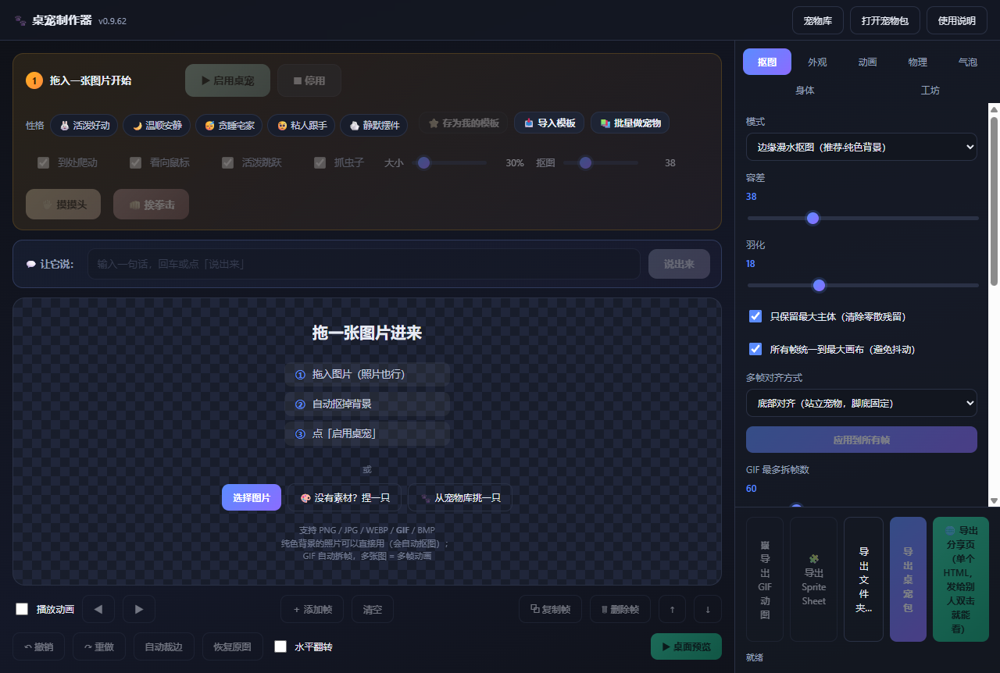
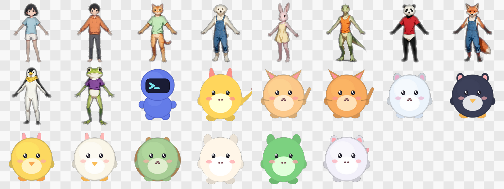

# 🐾 桌宠制作器 (Desktop Pet Maker)

把 **一张图片、一个 GIF、或一组多帧图片** 变成一只住在你桌面上的宠物，并可用 **离线 AI 一键抠图**。跨平台（Windows / macOS / Linux），基于 Electron，无需 Python / Rust。



**32 只内置宠物，开箱即用**（22 只程序化原创 + 10 只 AI 立绘）：



> 技术选型参考了这些开源项目：`B666T/DesktopPetGenerator`（上传图→抠图→动画→打包）、
> `PC2005-cloud/dsh-pet`（宠物包 / 素材链思路）、`ln2146/ai-desktop-pet-generator`（抠图→精灵流水线）。
> 差异化：**跨平台 + 纯 Node 零编译 + 离线 AI 抠图（ONNX）+ 自研 GIF 拆帧 + 自研物理引擎 + 快速模式（上传即用）**
> + **3688 项单测 + 45 套 e2e**。

---

## ⬇️ 直接下载（免安装）

**[下载 Windows 免安装版 v0.9.62](https://github.com/qianjiao626/desktop-pet-maker/releases/download/v0.9.62/desktop-pet-maker-win32-x64-v0.9.62.zip)**
（解压后双击 `desktop-pet-maker.exe` 即可运行，无需安装）

**Linux x64**（v0.9.62）：
```bash
npm run package:linux     # 解压 dist/desktop-pet-maker-linux-x64.zip 后执行 ./desktop-pet-maker
```

> **macOS**：本机（Windows）无法打包 —— `.app` 需要符号链接（需管理员/开发者模式），
> 且未签名应用会被 Gatekeeper 拦截（arm64 会被系统直接终止），需要 Apple 证书签名 + 公证。
> 请在 Actions 页面手动运行 `package` 工作流（`ci/package.yml`）在 `macos-latest` 上构建。

> 想看全部版本与更新说明：[Releases 页面](https://github.com/qianjiao626/desktop-pet-maker/releases)

---

## ⚡ 最简单的用法（推荐）

```bash
npm start
```

1. 把一张图片拖进窗口
2. 点 **▶ 启用桌宠** —— 桌宠立刻出现在屏幕上
3. 想让它动就在左侧勾选 **让他到处爬动**；想互动就点 **✋ 摸摸头**
4. 不想要了，点 **■ 停用**

不需要导出、不需要安装、不需要配置抠图——上传完就能用。
桌宠会自己走路、发呆、打瞌睡，点击它就会做出「被摸头」的反应。

> 需要精修（抠图、对齐、气泡、物理参数、AI 抠图、导出分享包）时，再用右侧的完整面板。

## 📖 完整使用教程

> 从「什么都没有」到「桌面上跑着你的宠物」，下面按场景走。**新手只看第 1 节就够了。**

### 0. 先拿到程序

三种方式，任选一种：

| 方式 | 怎么做 | 适合谁 |
|---|---|---|
| **下载免安装版**（推荐） | 下 `desktop-pet-maker-win32-x64-v0.9.62.zip`，解压，双击 `desktop-pet-maker.exe` | 只想用，不想折腾 |
| 自己构建 | `npm install` → `npm start` | 想改代码 |
| Linux | `npm run package:linux`，解压后 `./desktop-pet-maker` | Linux 用户 |

**不需要安装 Node、Python 或任何运行时** —— 下载版已经把 Electron 和 AI 引擎打包进去了。

---

### 1. 三分钟上手：一张图变成桌宠

这是最短路径，**不导出、不配置、不抠图**：

1. 打开程序，把**一张图片**直接拖进中间的方框
   （PNG / JPG / WEBP / GIF / BMP 都行；**背景是纯色或渐变的照片会自动抠图**）
2. 点 **▶ 启用桌宠**
3. 完事 —— 宠物已经出现在桌面右下角，会自己走动、发呆、打瞌睡

**想立刻互动：**
- 把鼠标移到它身上 → 它会**看向你的鼠标**
- 点它一下 → **摸摸头**（有反应动画）
- 拖住它甩出去 → 它会**挣扎**，松手后按你甩的方向飞出去

**不想要了：** 点 **■ 停用**，或看下面「[怎么关掉桌宠](#9-怎么关掉桌宠三种方式)」。

---

### 2. 场景：一张普通照片

拖进去就行，程序会**自动判断背景类型**：

- 纯色背景（白墙、绿幕、纯色布）→ 自动抠掉
- 渐变背景（墙面、天空、桌面）→ 也能识别并抠掉
- 杂乱背景（街景、复杂纹理）→ **自动跳过**，避免把主体也抠坏

抠完之后，预览下方会直接给结论：

| 提示 | 含义 | 怎么办 |
|---|---|---|
| 「背景已扣干净」 | 完美 | 什么都不用做 |
| 「边缘还有残留，把强度调大」 | 抠少了 | 右侧「抠图」页把**容差**调大 |
| 「主体被扣没了，把强度调小」 | 抠多了 | 把**容差**调小 |

> **为什么不做"一刀切"？** 因为容差和主体颜色有关。实测：AI 画的浅灰背景和角色的**白毛**颜色极近（最大通道差只有 26），容差写死会把白毛一起吃进去。所以程序会**逐张图自己试出最合适的容差**。

**背景太复杂、自动抠不干净？** 用内置的离线 AI 抠图：

1. 右侧「抠图」页 → 模式选 **AI 智能抠图**
2. 第一次要下载模型（**只需一次，之后永久离线**）：
   - 动漫/二次元角色 → 选「动漫角色」
   - 真人照片 / 实物 → 选「通用（精确）」
   - 想快 → 选「通用（快）」
3. 点「应用到所有帧」

模型大小 43～180MB，纯本地 CPU 推理，**图片不会上传到任何服务器**。

---

### 3. 场景：GIF 或一组多帧图

- **拖入 GIF** → 自动拆帧，并保留每一帧的原始延迟
- **一次拖入多张图** → 每张成为一帧（按文件名排序）
- **拖入一组图** → 想一次批量做成多只宠物，见第 6 节

多帧时建议在「抠图」页勾上：

- ✅ **只保留最大主体** —— 清掉零散残留色块
- ✅ **所有帧统一到最大画布** —— 避免播放时画面忽大忽小
- **多帧对齐方式** 选「底部对齐」—— 站立的宠物脚底固定，不会上下抖

---

### 4. 场景：没有素材，也不会画画 → 用「工坊」捏一只

点右上角 **「宠物库」旁边的「工坊」页**，或者空状态里的 **「😶 没有素材？捏一只」**。

**工坊能调什么：**

| 项目 | 选项 |
|---|---|
| **形体** | 「圆滚滚」（宠物）/「小人」（有头有身子） |
| 配色 | 主色 / 副色 / 眼睛 / 腮红 |
| 体型 | 大小 / 胖瘦 / 头身比 |
| 五官 | 眼睛 / 嘴 / 腮红 |
| 附加 | 耳朵 / 尾巴 / 手脚 |

左侧**实时预览**，改一个滑块就动一下。

**让它跳舞（这是工坊的招牌功能）：**

1. 「形体」选 **小人**（有头有身子的 Q 版小人）
2. 「舞蹈」里有 **8 种**：蹦蹦 / 招手 / 扭扭 / 侧步 / 点头 / 转圈 / 打招呼 / 狂欢
3. 选了之后**左侧预览当场就动**，不用先导出再猜
4. 想让它有多个动作：
   - 点 **「✨ 一键存全部舞步」** 一次存下 8 段（最省事）
   - 或选一个舞步 → 点「💃 存为动作片段」→ 换个舞步再存
5. 导出后，桌宠会**每隔几秒随机换一个动作**

> 小人形体下还有「头的大小 / 躯干长度 / 腿的长度 / 手臂长度」四个滑块可微调比例。

---

### 5. 场景：用一张真人照片，捏出一个会跳舞的小人

**这是"识别身体部位"这个功能的真正用法。**

1. 左侧切到 **「身体」页**
2. 上传一张**正面、全身、四肢张开**的照片（四肢并拢的照片识别率会大幅下降）
3. 点 **「🧍 照着照片捏一个小人」**
4. 工具会读出他的**头身比 / 腿长 / 臂长 / 站姿**和**主色**，照着捏出一个**可动的小人**
5. 然后按第 4 节的办法给它加舞步

**⚠️ 为什么照片本身不能直接跳舞？**

照片没有背面、没有关节内侧、没有被遮挡肢体的像素。任何"搬运像素"的做法都会穿帮
（这个项目实测了三条渲染路线，全部失败，记录在 `HANDOFF.md` 已知坑第 23 条）。

所以这里走的是另一条路：**照片只当参照（提供比例与姿势），像素由程序重新画** ——
所以抬手后腋下长什么样，程序知道，不存在信息缺失。这也正是专业 2D 骨骼动画
（Spine 等）的做法：**绑骨、重绘**，而不是扭曲照片。

---

### 6. 场景：一次做一批宠物

**批量做**：点 **「批量做宠物」** → 一次拖入多张图 → 每张各成一只独立宠物并自动入库。

**用 AI 生成的立绘做**（进阶，能拿到最好看的角色）：

1. 打开 `素材/工单_豆包生成素材.md`，把里面的提示词整段复制给 AI 绘画工具
   （豆包 / 即梦 / 文心 / 通义都行，工单里中英文提示词都有）
2. 出图后放进 `素材/原始素材/`
3. 跑自检，看每张图合不合格：

```bash
npm run check:assets      # 逐张报告 17 个关键点识别情况 + 具体修改建议
```

4. 合格后批量做成宠物：

```bash
npm run make:pets           # 生成 .petpack 到 素材/做好的宠物/
npm run make:pets:install   # 顺便装进宠物库，立刻能上桌
npm run check:pets          # 校验产物（帧齐全 / 尺寸一致 / 主体非空）
```

**关键提示词要点**（工单里有完整版）：

- ✅ 正面、全身、**四肢张开**、双腿微开、手不拿东西
- ✅ 写实比例 + 明暗（不要大头 Q 版 —— 身体识别是在真人照片上训练的，认不出 Q 版）
- ✅ 干净背景（纯色或浅灰）
- ❌ 排除 chibi、arms crossed、legs together

---

### 7. 场景：养多只 + 分类 + 亲密度

**多只同屏：**
1. 点右上角 **「宠物库」**
2. 点 **「☑ 多选」** 勾几只
3. 点 **「▶ 一起放出来」**

它们会各走各的、位置自动错开。**靠近了还会互相看一眼、让个路、或者一起蹦一下。**

**分类：** 点卡片上的 **🏷** 打标签（一只可同属多个分组），顶部分组栏一点就只看该组。

**收藏：** 点卡片左上角 **★**，收藏的自动排最前。

**亲密度：** 只统计**最近 30 分钟**的互动（摸头/戳/说话）。从 陌生 → 眼熟 → 熟络 → 亲密，
越熟越爱主动找你说话。很久不理它会自然淡下去。

**找宠物：** 顶部搜索框按名字过滤，也能按名字 / 体积 / 帧数排序。

---

### 8. 场景：分享给别人

三种方式，按对方的情况选：

| 方式 | 对方要做什么 | 适合 |
|---|---|---|
| **导出分享页**（单个 HTML） | 双击用浏览器打开就能看它动，页面里有「⬇ 保存宠物包」按钮 | 发给不懂电脑的人 |
| **导出桌宠包**（`.petpack`） | 把文件拖进制作器窗口，自动安装并上桌 | 对方也装了本工具 |
| **导出在线分享站** | 整个宠物库变成一个静态网站（卡片网格 + 搜索 + 每只一个页面），可传 GitHub Pages | 想公开分享一堆宠物 |

导出的分享站文件夹里自带一份中文图文 **《发布到网上.md》**，写了网页上传步骤、
Netlify 一键拖拽、局域网给身边人看，还有 FAQ。**不熟悉 GitHub 的人也能自己发出去。**

---

### 9. 怎么关掉桌宠（三种方式）

| 方式 | 怎么做 | 说明 |
|---|---|---|
| **托盘菜单**（推荐） | 任务栏右下角托盘图标 → 右键 → 「退出桌宠」 | 养多只时会**逐只列出来**，可点名关掉某一只 |
| **全局快捷键** | `Ctrl+Alt+Q` | 任何情况下都有效，包括鼠标穿透时 |
| **右键菜单** | 鼠标移到**桌宠身上**（不是周围空白）右键 → 退出桌宠 | 需要点准 |

**其他快捷键：**

| 快捷键 | 作用 |
|---|---|
| `Ctrl+Alt+Q` | 强制退出桌宠 |
| `Ctrl+Alt+P` | 显示 / 隐藏桌宠 |
| `Ctrl+Alt+R` | 把它找回来（**丢到屏幕外时很有用**） |

> **关掉制作器窗口后**，托盘图标会继续留在任务栏右下角，随时可以右键退出桌宠或重开制作器。

**让它安静一点（不关掉）：** 右键桌宠 → 「暂停走动（待在原地）」或「静音气泡」——
专心工作时不用关掉它。

---

### 10. 常用设置

**性格模板（一键预设）：** 快速条上一排 5 种 —— 活泼好动 / 温顺安静 / 贪睡宅家 / 粘人跟手 / 静默摆件。
点一下就把动画·物理·气泡·行为一起配好。**只改性格字段，不动你的图片和画布。**

**省电：** 默认开启。静止/打瞌睡时自动降帧（10~20fps），走路 30fps，拖拽时满帧。
**降帧不改变物理**，走起来不会变慢。想要最顺的画面就去「物理」页关掉。

**作息：** 跟着真实时间变 —— 清晨刚醒（有点懵）/ 上午最精神 / 午后发乏 / 深夜犯困 / 凌晨基本在睡。
只改行为倾向，不动图片与参数，可一键关闭。

**让它说话：** 「气泡」页写台词。宠物会对摸头 / 被戳 / 被拎起来 / 睡醒等真实事件说话，
口吻跟着「性格」走。

---

### 11. 出问题了怎么办

| 现象 | 原因与解法 |
|---|---|
| **AI 抠图下载不了模型** | 国内网络下部分 CDN 不可达。已内置 4 个备用源自动切换；若仍失败，可手动下载后放到 `%APPDATA%\desktop-pet-maker\models\` |
| **桌宠找不到了** | 按 `Ctrl+Alt+R` 把它叫回来 |
| **桌宠关不掉** | 按 `Ctrl+Alt+Q`（全局快捷键，一定能退） |
| **抠图把主体吃掉了** | 「抠图」页把**容差调小**；或勾掉「只保留最大主体」 |
| **边缘还有一圈残留** | 把**容差调大**，或调大**羽化** |
| **动画播放时上下抖** | 勾「所有帧统一到最大画布」，对齐方式选「底部对齐」 |
| **导入后画面很小/很大** | 「外观」页调**大小**滑块，或调 `render.scale` |
| **程序打不开** | 确认解压完整（不要直接在压缩包里双击运行） |

**还搞不定？** 去 [Issues](https://github.com/qianjiao626/desktop-pet-maker/issues) 提一个，
带上你的图片和截图，我会看。

---
## ✨ 功能

**制作器（Maker）**
- 拖拽 / 选择图片，支持 PNG / JPG / WEBP / GIF / BMP
- **拖入 GIF 自动拆帧**为多帧动画，并保留每帧原始延迟（可选用统一帧率覆盖）
- **从单张静态图生成动画**：6 种程序化运动（呼吸 / 漂浮 / 摇摆 / 跳跃挤压 / 点头 / 摇滚位移），
  一键合成无缝循环的多帧序列——解决"只有一张图、宠物动不起来"
  - 采样使用**预乘 alpha**，避免透明边缘出现黑边光晕
  - 位移/旋转按图像尺寸缩放，大图不会出现"动作几乎看不见"
  - 自动扩展画布，动作不会被边缘裁切
- **AI 智能抠图（离线）**：ONNX 模型本地推理，无需联网、不上传图片，适合复杂/照片背景；三个可选模型全部 Apache-2.0
  - 动漫角色：专为二次元角色训练，桌宠首选
  - 通用（快） / 通用（精确）：通用主体
- 两种纯本地抠图算法（零依赖、即时、无需下载模型）：
  - **边缘漫水抠图**：从四边向内扩散，只删与边界连通的背景色 → 保住主体内部同色区域（推荐）
  - **颜色阈值抠图**：按背景色全局删除
- 容差 / 羽化 / 自动裁边 / 水平翻转
- **只保留最大主体**：一键清除零散残留色块
- **多帧统一画布 + 主体对齐**：底部 / 中心 / 质心三种对齐方式，消除播放抖动（实测两帧底边完全一致）
- **文件名安全化**：安装/导出时对包名做清理（路径穿越、Windows 保留名、超长、非法字符），
  且安装为**原子写入**（先写临时文件再 rename），中途失败不会留下损坏的半包
- **大头照 → Q 版身体**：上传一张**已抠好背景的大头照**，会自动长出 Q 版小短腿与小圆手，
  并生成 12 帧循环动画。两种动作模式：**走路**（双腿交替 + 身体起伏）/ **爬动**（对角步态，手脚并用）。
  四肢配色自动取自头像主色调，风格统一。纯本地合成，无需联网。
- **上传即用（自动抠图）**：拖入一张照片就会**自动识别纯色背景并抠掉**，
  不需要手动配置就能得到干净的桌面宠物。检测基于「四边像素是否同色」，
  已带透明通道的 PNG 不受影响。
- **内存预算保护（制作器 + 运行时双端）**：
  - 制作器：按帧尺寸自动限制帧数（默认 512MB 上限），避免 1600×1600 × 300 帧（原需 5.7GB）撑爆渲染进程
  - 运行时：加载他人分享的 `.petpack` 时自动**均匀抽稀**（保留首末帧，动画仍连贯）并提示，
    即使收到 240 帧 × 1600×1600 的膨胀包也不会崩溃
- 帧序列可视化：上一帧 / 下一帧 / 播放动画预览
- **键盘快捷键**：`←/→` 切帧、`空格` 播放/暂停、`Home/End` 首尾帧、
  `Ctrl+Z` 撤销、`Ctrl+Shift+Z` 重做、`Shift+Delete` 清空、`Shift+Enter` 让它说话
  （**焦点在输入框里时绝不抢键** —— 空格/方向键在那里是刚需）
- **键盘也能调帧顺序**：`Ctrl+← / Ctrl+→` 把当前帧往前/往后挪，
  不用鼠标拖也能排序（**键盘可访问**：只用键盘就能完成删帧 / 复制 / 换序全套操作）
- **帧缩略图条**：整段动画可视化成一条缩略图，点哪帧切哪帧、拖动可排序；
  **把一张新图拖到某一格上，就只替换那一帧**（新图自动等比缩放并居中到原帧画布，
  整段动画不会忽大忽小地抖动），改坏了随时 `Ctrl+Z` 撤销
- **撤销 / 重做**：抠图、裁边、翻转、生成动画、自动适配、帧编辑都可逐步回退
- 帧序列编辑：删除 / 复制 / 上移 / 下移，复制帧自动深拷贝像素、帧名自动去重
- 五类参数可视化调节：抠图 / 外观 / 动画 / 物理 / 气泡
- **桌面预览**：一键在真实桌面启动试用
- 导出为单文件 **`.petpack`** 或文件夹
- **分享站自带发布指南**：导出的文件夹里有一份中文图文 `发布到网上.md` ——
  网页手动上传步骤（3 分钟）/ Netlify 等一键拖拽托管 / 局域网给身边人看，
  还有 FAQ（要不要联网、花不花钱、隐私）。让不熟悉 GitHub 的人也能自己发出去
- **🎨 角色工坊（捏一只自己的）**：没有素材、也不会画画？在「工坊」页从一堆滑块捏一只 ——
  **形体可选「圆滚滚（宠物）」或「小人（有头有身子）」**，
  配色 / 体型 / 耳朵 / 眼睛 / 嘴 / 腮红 / 尾巴 / 手脚，左侧**实时预览**。
  **纯程序化绘制**：零依赖、秒出、不联网、不花钱、原创无版权风险。
  一键生成 4–24 帧的上下浮动动画，直接进制作器当桌宠，也可以只替换当前帧。
  捏好的配置能存成 `.petchar.json` 备份 / 发给朋友
- **💡 内置 AI 素材提示词**：没有素材、或生成出来识别不出？「身体」页有折叠的
  提示词区，一键复制英文/中文/反向提示词。里面每条要求都对应一个**实测过的判据**：
  写实比例 + 四肢张开能识别 **16/17** 个点，而大头 Q 版只有 9/17、四肢并拢只有 8/17
  （后两种会被直接拒绝）
- **🧍 照着照片捏一个小人**：上传一张正面人物照，点「照着照片捏一个小人」——
  工具用身体识别读出**头身比、腿长、手臂长和站姿**，还会**从照片里取主色**，
  照着他的比例和颜色重画一个**可动小人**，然后就能跳那 4 种舞。
  **矮胖 / 标准 / 高瘦会捏出明显不同的身材**（比例先归一化再映射到可爱区间，
  既保留"高个子腿更长"的差异，又不会画出火柴人）。
  捏完后还能用**身体比例滑块**（头的大小 / 躯干长度 / 腿的长度 / 手臂长度）自己微调 ——
  识别不准时不用重来
  ⚠️ 为什么这条路行、而「让照片本身跳舞」不行：让照片跳舞要**搬运像素**，
  但照片没有背面、没有关节内侧、没有被遮挡肢体的像素，补不出来；
  这里做的是**换介质** —— 照片只当参照，像素由我们重新画，
  抬手后腋下长什么样我们知道。专业 2D 骨骼动画（Spine 等）也是这么做的
- **🧍 捏一只「小人」（不只是圆滚滚宠物）**：形体切到「小人」就是**有头有身子**的 Q 版小人 ——
  头、脖子、躯干、手脚分开画，五官长在脸上、手脚长在躯干上。
  小人**一样能跳那 4 种舞**（同一套舞蹈机制）。
  ⚠️ 这也是「画一个小人 → 操控他跳舞」这句里**"画小人"**那半边的兑现：
  以前工坊只能捏出圆滚滚的宠物，捏不出人
- **💃 让他跳舞（8 种舞步）**：蹦蹦 / 招手 / 扭扭 / **侧步 / 点头 / 转圈 / 打招呼** / 狂欢 ——
  手绕肩、脚绕髋真的摆起来，还会**左右踏步**、**点头**、**侧头看你**，
  工坊预览里**当场就能看到在跳**（不用先导出再猜）。
  ⚠️ 为什么只有「捏的小人」能跳舞：静态照片没有背面、没有关节内侧、没有被遮挡的肢体像素，
  任何"搬运像素"都补不出来（三条渲染路线都实测失败）；而绘制小人的像素是**我们自己画的**，
  抬手后腋下是什么颜色我们**知道**，重画一遍即可 —— 这是它和照片的本质区别。
  另外会按体型算出**安全抬起上限**，所以举手永远不会伸出画布被裁掉
- **一只宠物能装多个舞步**：工坊里点「💃 存为动作片段」把当前舞步存下来，
  换个舞步再存一段 —— 多存几段后导出，桌宠上桌会**每隔几秒随机切换动作**，
  而不是永远重复同一个舞步（主帧不动，可随时撤销）。
  嫌一个个点麻烦？点「✨ 一键存全部舞步」一次存下 8 段。
  「跳舞速度」滑块可以让它跳快些或慢些（0.5× ~ 2×，预览与导出都跟着变）。
  每段还能用 **− / ＋** 调**出现频率** —— 想让「狂欢」比「招手」更常出现就把它调高
- **在线分享站（零后端）**：把整个宠物库一键导成一个**静态网站** ——
  `index.html`（卡片网格 + 搜索）+ 每只宠物一个自包含分享页 + `manifest.json` + 发布说明。
  **分享页里也能看到跳舞**：宠物包里的多段动作会一并带过去，随机切换播放
  （以前只播主帧，别人打开只看到"一直在呼吸"）
  整个文件夹传上 **GitHub Pages / Netlify / Cloudflare Pages** 就能给人逛，不需要服务器、不需要数据库

**运行时（Pet）**
- 无边框透明置顶窗，**canvas 多帧渲染**（呼吸 / 摇摆 / 逐帧循环 / 逐帧一次）
- 拖动移动、**松手甩出**（真实测速 + 惯性 + 重力 + 落地弹跳）
- 自动桌面漫游、边界碰撞反弹
- 点击反馈（弹跳 / 跳跃 / 抖动 / 旋转）+ 悬停放大
- **交互特效**：素材为黑线稿图片（src/pet/assets/），运行时自动**抠掉白底**、按宠物尺寸缩放，
  并做朝向矫正与方向镜像——摸头时手从上方伸下、指尖精确落在头顶；挨拳击时拳头从侧方**落到身体上**，
  配冲击星芒与冲击线
- **摸头（rua 它）会更"舒服"**：专属的摸头姿态——轻轻压扁 → 下沉蹭一蹭 → 左右摇摆歪头 → 回原样，
  同时头顶飘出小爱心。与"点击弹跳"解耦，不会再像被弹了一下
- **抓虫子小玩法**（可在快速条勾选框关闭）：桌面上会随机爬出一只小虫子
  （六条腿会摆动、有触角与复眼）。宠物发现后会在窗口内凑过去，靠近就"扑"一下抓住，
  冒一句「抓到啦！」并飘出爱心与小星星；也可以**直接用鼠标点掉虫子**。
  虫子被追时会加速逃跑，跑累了会趴下歇一会儿
- 对话气泡（自定义台词、定时轮播、点击切换；摸头时自动上移避让手掌）
- **宠物右键菜单**：回到屏幕底部 / 说一句话 / 切换置顶 / 切换鼠标穿透 / 换个动作 /
  **放大一点 / 缩小一点 / 换个性格（运行时换对话口吻）/ 回到屏幕中央** / 退出桌宠
- **全局快捷键**（桌宠在跑时随时可用）：`Ctrl+Alt+P` 显示/隐藏、`Ctrl+Alt+R` 放回屏幕中央、
  `Ctrl+Alt+S` 让它说一句、`Ctrl+Alt+Q` 强制退出
- **记住上次位置**：行为选「记住上次位置」后，宠物挪到哪里、下次就还在哪里
  （这条以前是坏的 —— 位置从来没被保存过）
- **系统托盘常驻**：任务栏右下角托盘图标 → 右键可「退出桌宠 / 隐藏显示桌宠 /
  重开制作器 / 打开宠物库文件夹 / 退出制作器」。关掉制作器窗口后托盘仍在，不会"找不回来"
- **全局快捷键 `Ctrl+Alt+Q` 强制退出**：即使桌宠正在鼠标穿透、制作器窗口已关闭、
  或宠物跑到屏幕外，也能一键退出（避免"退不出去"）
- **像素级鼠标穿透**：空白区域自动穿透，只有点在宠物身上才响应
- **显示大小可调**：快速条「大小」滑块 / 鼠标滚轮 / 「外观」页滑块三处联动，
  调大小**实时生效**且保持"脚不离地"；默认 **30%**（可在 10%~300% 之间调整）
- **活泼跳跃**：桌宠会自己蹦一蹦（起跳 → 滞空 → 落地回弹，三段确定曲线），
  可在快速条用「活泼跳跃」开关关掉（喜欢安静的桌面就关它）
- **会打瞌睡**：闲下来会睡着 —— 呼吸变得又慢又沉、身体渐渐塌下去，睡熟后冒「Zzz…」
- **看向鼠标**：会朝你的鼠标方向瞄一眼（轻微倾斜 + 位移，幅度很小，**不追着鼠标跑**）；
  睡着时不看，可用快速条「看向鼠标」开关关掉
- **可以拎起来**：拖拽时会**挣扎**（左右晃 + 上下轻摆 + 略微拉长），
  甩得越快晃得越厉害；松手后按甩出的方向自然抛出去
- 位置记忆、多开支持

**宠物库**
- 已安装宠物一览（缩略图 / 帧数 / 体积）、一键启动 / 删除
- 安装 `.petpack` 到用户目录，随时调用
- **内置 32 只萌系宠物（22 只程序化原创 + 10 只 AI 立绘），首次启动自动装进库，开箱即用**
  - **风格统一**：全部为圆润萌系（大头 + 大眼双高光 + 腮红 + 呼吸/眨眼/摆手动画），
    比例参考 Codex 桌面小助手的审美，但**造型完全原创**，不复制任何第三方 IP
  - 1 只**小蓝机器人**（12 帧动画）：深蓝圆身 + 深色面罩 + 青色 `>_` 符号，逐帧呼吸/摆手/眨眼
  - 5 只**经典萌宠**：北极熊 / 大胖鸡 / 小企鹅 / 小黄鸭 / 咚咚（6 帧动画）
  - 2 只**猫咪**：喵喵 / 胖橘猫（6 帧动画，带胡须与摇尾）
  - 5 只**原创**形象：小黄龙 / 奶团子 / 喵喵 / 呱呱 / 咚咚（6 帧动画）
  - 6 只**小怪物**：小绿怪 / 小蓝怪 / 小红怪 / 小黄怪 / 小紫怪 / 小白怪（6 帧动画，带角/天线/鳍）
  - 5 只**形状小朋友**：小圆橙 / 小方绿 / 小菱红 / 小方正 / 小圆紫（6 帧动画，带头顶小揪揪）
  - 生成脚本在 `scripts/make-*.mjs`，全部程序化绘制、不依赖外部素材，可随时重跑
  - 原创形象不复制任何第三方 IP 的具体造型；历史 CC0 素材来源与许可见 `THIRD-PARTY.md`
  - **10 只 AI 立绘角色**（女孩 / 男孩 / 猫 / 狗 / 兔 / 恐龙 / 熊猫 / 狐狸 / 企鹅 / 青蛙）：
    写实赛璐璐风格、四肢张开的正面立绘，带呼吸 / 摇摆 / 蹦跳三段动作。
    由 `scripts/make-pets-from-assets.mjs` 从 AI 生成的立绘批量加工而成
    （自动挑抠图容差 → 抠背景 → 背景色去污染 → 裁边 → 生成动作 → 打包）
- **AI 立绘素材工作流**：`素材/工单_豆包生成素材.md` 是一份可直接交给 AI 绘画工具的
  **一次性出图工单**（含完整提示词、标准姿势、验收标准）；
  出图放进 `素材/原始素材/` 后：
  - `npm run check:assets` —— 跑身体识别，逐张报告 17 个关键点识别情况与修改建议
  - `npm run make:pets` —— 批量做成 `.petpack`
  - `npm run make:pets:install` —— 顺便装进宠物库，立刻能上桌
  - `npm run check:pets` —— 校验产物结构（帧齐全 / 尺寸一致 / 主体非空）
- **宠物库支持搜索与排序**：按名字过滤、按名字/体积/帧数排序、显示"n / N 只"计数
- **导出命名模板**：批量导出时可选命名规则（`{name}` `{n:03}` `{date}` `{time}` `{author}` `{ext}`），
  导出前会**用真实宠物名预览**一个文件名；写错占位符会提示；同名自动去重
- **宠物详情面板**：库卡片点 ⓘ 看完整信息（作者 / 帧数 / 动作片段数 / 画布 /
  体积 / 版本 / 分组 / 来源 / 文件位置），可直接启动、在文件夹里显示、复制路径
- **宠物包一键更新**：作者重新导出同一个包后，接收方拖进来时会**先告诉你是新版还是旧版**，
  再问要不要覆盖（旧包会明确警告，避免误把新版盖回旧版）
- **宠物记住你**：只统计**最近 30 分钟**的互动（摸头/戳/说话…），
  亲密度从 陌生 → 眼熟 → 熟络 → 亲密；越熟越爱主动找你说话。
  用了**滑动窗口**（参考 codachi 的 XP 思路）：很久不理它会自然淡下去，不会假装还亲密
- **作息**：跟着真实时间变 —— 清晨刚醒（有点懵）/ 上午最精神 / 午后发乏 /
  深夜犯困 / 凌晨基本在睡。只改行为倾向，不动图片与参数，可一键关闭
- **省电模式开关**：制作器「物理」页可实时开关（关掉就一律满帧，更顺但更费电）
- **省电节流**：宠物静止 / 打瞌睡时自动降帧（10~20fps），走路 30fps，
  被拖拽 / 有特效时满帧 —— **降帧不改变物理**，走起来不会变慢
- **宠物之间会互相感知**：养多只时它们能看见彼此 —— 靠近了会转头看、
  让个路、或者一起蹦一下（有冷却与概率，不会几只凑一起就吵成一团）
- **托盘能看到/关掉每一只**：养了多只时，托盘菜单会逐只列出来，
  可以直接点名关掉某一只，不用去屏幕上找它
- **右键一键「安静」**：宠物右键菜单里有「暂停走动（待在原地）」和「静音气泡」——
  专心工作时不用关掉它，也不用回去改设置
- **放出来时有进度**：一次放多只时逐只回报「正在放出来… 2/3（大胖鸡）」+ 底部进度条，
  不会点了之后一片空白让人以为没反应
- **多宠物同屏**：宠物库里点「☑ 多选」勾几只 -> 「▶ 一起放出来」,
  它们会各自独立地住在桌面上（各走各的、互不影响），位置自动错开
- **宠物库分组**：给宠物打标签归类（一只可同属多个分组），分组栏一点就只看该组，
  右键分组可改名 / 删除；分组偏好只存本地，不写进 `.petpack`（不污染可分享的包）
- **上传即用（含渐变背景）**：拖入照片会自动检测并抠掉纯色**或渐变**背景
  （墙面 / 天空 / 桌面这类常见背景都能识别；杂乱背景会自动跳过，避免误伤主体）
- **性格模板（一键预设）**：快速条上一排 5 种性格 —— 活泼好动 / 温顺安静 / 贪睡宅家 /
  粘人跟手 / 静默摆件，点一下就把动画·物理·气泡·行为一起配好。
  新手不用理解那 20+ 个参数；模板**只改性格相关字段**，不动你上传的图片、画布与外观
- **抠图质量反馈**：预览下方直接给出结论 —— 「背景已扣干净」或
  「边缘还有残留，把强度调大」/「主体被扣没了，把强度调小」，并显示主体占比。
  透明背景在棋盘格上很难看清扣得干不干净，这条提示把这个判断直接告诉你
- **拖入即用**：把 `.petpack` 直接拖进制作器窗口，自动安装并立刻出现在桌面上
  （收到别人分享的宠物包时，这是最短的一条路径）
- **一键分享闭环**：导出成功后弹窗给出「复制文件路径」与「打开所在文件夹」，
  并明确告诉对方怎么用（拖进窗口即可）
- **收藏与最近使用**：卡片左上角星标即可收藏（★），收藏的自动排在列表最前；
  顶部可切「★ 收藏 / 最近」快速找到常用的那几只。偏好存在 `userData/library.json`，
  不写进 `.petpack`（不污染可分享的宠物包）；删除宠物时会自动清掉它的收藏与历史记录

---

## 🚀 快速开始

```bash
npm install                 # 安装依赖（仅 Electron）

npm start                   # 打开制作器
npm test                    # 3688 项单元测试
npm run test:e2e            # 45 套端到端测试（含防假绿自检：套件失败一定返回非 0 退出码）
npm run package             # 打包为免安装目录（dist/）
npm run selftest            # AI 引擎自检
npm run examples            # 生成示例宠物（多帧动画）

# 直接启动一只宠物
npm run pet -- --pet="examples/小蓝机器人.petpack"
```

### 完整流程

1. `npm start` 打开制作器
2. 把图片拖进画布（多张 = 多帧动画），或点「选择图片」
3. 「抠图」页调模式 / 容差 / 羽化，点「应用到所有帧」
4. 「动画」页选择待机动作（多帧可选「播放所有帧（循环）」）
5. 只有一张图时，用「从单张图生成动画」选运动类型并生成多帧
6. 勾选「播放动画」预览，用 ◀ ▶ 单帧检查
7. 点「▶ 桌面预览」真实体验（右键可退出）
8. 「导出桌宠包」得到 `.petpack`，或在「宠物库」安装

---

## 📁 项目结构

```
桌宠制作器/
├── package.json
├── src/
│   ├── main/main.js             # Electron 主进程：窗口 / 文件 / 宠物库 / 快速启用 / IPC
│   ├── main/state.js            # 主进程共享状态（当前宠物包 / 窗口引用）
│   ├── preload/preload.cjs      # 安全桥（必须是 CommonJS）
│   ├── shared/
│   │   ├── petpack.js           # 宠物包规范 v2（归一化 / 钳制 / v1 迁移）
│   │   ├── imageops.js          # 纯图像算法（抠图/裁边/连通域）
│   │   ├── physics.js           # 纯物理（重力/弹跳/摩擦/甩出测速）
│   │   ├── displays.js          # 多显示器工作区选择（按窗口位置选边界）
│   │   ├── budget.js            # 多帧内存预算（限制帧数避免 OOM）
│   │   ├── safeid.js            # 文件名安全化（路径穿越/保留名/限长）
│   │   ├── behavior.js          # 待机行为状态机（爬动/发呆/打瞌睡/摸头）
│   │   ├── zip.js               # 零依赖 ZIP 读写
│   │   └── png.js               # 零依赖 PNG 编码器
│   ├── maker/                   # 制作器界面
│   └── pet/                     # 宠物运行时（canvas 渲染）
├── scripts/make-examples.js     # 程序化生成多帧示例宠物
├── tests/                       # 3688 项单元测试（npm test）
├── examples/                    # 示例宠物包
└── README.md
```

## 📦 宠物包格式（.petpack，schema 2）

ZIP 内含 `pet.json` + 若干帧图片 + `README.txt`：

```jsonc
{
  "schema": 2,
  "name": "我的桌宠",
  "author": "",
  "frames": [                                  // 帧序列
    { "file": "frame_000.png", "durationMs": 120 },
    { "file": "frame_001.png", "durationMs": 120 }
  ],
  "canvas": { "width": 320, "height": 320 },   // 统一画布
  "render":    { "scale": 0.6, "flip": false },
  "animation": { "idle": "play", "idleSpeed": 1, "fps": 12, "click": "bounce", "hover": "grow" },
  "physics":   { "gravity": 1.2, "bounce": 0.55, "friction": 0.985, "roam": true, "roamSpeed": 1, "throwScale": 1 },
  "bubble":    { "enabled": true, "lines": ["你好呀～"], "intervalSec": 14, "durationSec": 3.2 },
  "behavior":  { "startCorner": "bottom-right", "keepAbove": true }
}
```

- `animation.idle`：`breathe` / `sway` / `play`（循环播放所有帧）/ `once`（播放一次）/ `none`
- 运行时读取会做**归一化与范围钳制**，非法值不会崩溃
- **兼容 schema 1**：旧的 `image` / `imageSize` 会自动迁移为单帧

## 🛠 技术栈

| 模块 | 技术 |
|------|------|
| 运行时容器 | Electron（透明无边框窗 + 屏幕坐标控制） |
| 渲染 | HTML5 Canvas 2D（多帧 + 变换） |
| 抠图 | 自研漫水 / 阈值 + 连通域（纯本地） |
| 物理 | 自研（重力 / 弹跳 / 摩擦 / 甩出测速） |
| GIF 处理 | 自研解析器 + 内联 gifuct-js 的 LZW（MIT） |
| 打包格式 | 自研 ZIP 读写（零第三方依赖） |
| 交互 | 像素级 alpha 命中测试 + `setIgnoreMouseEvents` 穿透 |
| 测试 | 自研断言框架：3688 项单测 + 45 套 e2e（真实驱动 UI / 宠物 / 宠物库 / 打包 / 分享站 / 角色工坊 / 对话） |

## 🧪 测试

```bash
npm test
```

覆盖：抠图（含"主体内部同色被保留"这一关键差异）、裁边、连通域、羽化、物理（重力/弹跳/边界/漫游/甩出测速/钳制）、宠物包归一化与 v1 迁移、ZIP/PNG 编解码、**GIF 解码（用真实 dog.gif 与 gifuct-js 逐像素交叉验证，0 处不一致）**。

调试渲染进程可设 `PETMAKER_DEBUG=1`，会输出渲染进程 console 与加载错误。

## ⚠️ 已知限制

- 自动补帧目前是**程序化仿射**（缩放/旋转/位移），不是 AI 生帧；大幅度动作（如换姿势）仍需多帧素材
- 生成动画后仍可继续调整抠图/裁边/翻转（生成帧保留对源帧的引用）
- 纯本地抠图对**复杂背景**（杂乱纹理/多主体）仍不如 AI —— 这种图建议用内置的离线 AI 抠图
- AI 抠图**已接入**（ONNX 离线）。注意：**不使用** @imgly/background-removal（AGPL-3.0，与本项目 MIT 不兼容），也**不使用** ria-rmbg（商用需付费）。所选三个模型均为 Apache-2.0
- AI 模型需**首次下载**（43–180MB，从 GitHub Releases）；推理为 CPU，512×512 约 0.5 秒/帧
- **造宠物**走参数化原创路线（角色工坊），不做 AI 生图；**对话**是本地规则脑，不接 LLM —— 理由见下方对比表

- 逐帧动画的**统一画布**假设各帧主体位置一致；若源图主体位置差异大，可能需要手动对齐

## 🗺 路线图

- [x] AI 抠图（本地 ONNX，三个模型全 Apache-2.0；**不用** AGPL 的 @imgly）
- [x] GIF 导入自动拆帧（含每帧原始延迟与内存预算抽稀）
- [x] 造宠物：**参数化原创角色工坊**（零依赖、秒出，取代「AI 生图」路线 —— 见下方说明）
- [x] 宠物对话：**本地规则对话脑**（按性格换口吻、事件驱动、零联网零费用）
- [x] 跨平台产物：Windows / Linux 可直接打包（pack.mjs / pack-cross.mjs）；macOS 走 CI
- [ ] macOS 代码签名 + 公证（需要 Apple Developer 证书）
- [x] 宠物包在线分享站（零后端静态站点：卡片网格 + 搜索 + 每只一个自包含页面，可上 GitHub Pages）

## 🎨 为什么是「参数化造宠物」而不是「AI 生图」

两条路都试过，结论是参数化才是这个工具该走的路：

| | AI 生图（本地模型） | AI 生图（在线 API） | **参数化角色工坊** |
|---|---|---|---|
| 依赖 | 几百 MB~1GB 模型 | 要联网 + 用户自己的 Key | **零依赖** |
| 速度 | CPU 上 10 秒~1 分钟/张 | 几秒，但要排队 | **毫秒级** |
| 花钱 | 免费但费电 | 按张计费 | **永久免费** |
| 版权 | 模型训练数据不明，商用有风险 | 同左 | **100% 原创、无风险** |
| 可控性 | 抽卡，想要 A 常给 B | 抽卡 | **每个部位都能调** |

桌宠的核心诉求是「**人人都能做出来**」，不是「人人都能抽到好看的图」。
所以选了参数化：门槛最低、结果可控、永不翻车。

## 🤖 AI 抠图实现要点

三个模型的**前处理各不相同**，这是实现中最容易踩的坑（实测得出，勿凭直觉改）：

| 模型 | 输入尺寸 | 缩放 | mean | std |
|---|---|---|---|---|
| silueta | 320 | ÷ 图像最大通道值 | ImageNet | ImageNet |
| isnet-general-use | 1024 | ÷ 255 | 0.5 | 1 |
| isnet-anime | 1024 | **不缩放（原始 0..255）** | 0 | 1 |

另有差异：isnet-anime 采用 **letterbox**（保持宽高比填充，对齐官方 anime-segmentation），另两个用直接拉伸。isnet-anime 对瘦高立绘能减少形变。

- `isnet-anime` 的 ONNX 导出**已内置归一化**，若再除 255，输出会整体塌陷到 ~0.005（表现为"抠不出任何东西"）
- `silueta` 遵循 rembg `base.normalize`：先除以图像最大值，再减 mean 除 std
- 输出统一做 **min-max 归一化**（对齐 rembg 后处理），再作为 alpha 掩膜
- 位图来自 Electron `nativeImage.toBitmap()`，顺序为 **BGRA**（已实测校准）
- 推理为 CPU 单线程：320 模型约 0.5s，1024 模型约 0.9s（512×512 输入）

验证脚本：

```bash
npm run test:e2e:segment     # 三模型逐一推理，检查覆盖率/中心 alpha/四角 alpha
npm run test:e2e:pipeline    # GIF 拆帧 → 逐帧 AI 抠图 → 打包 → 回读
npm run test:e2e:download    # 模型缓存/损坏识别/删除
```

## 🐛 已修复的两个关键缺陷（实现要点）

### 1. 宠物窗口在非整数 DPI 缩放下持续膨胀（致命）

**现象**：桌宠窗口每秒触发约 50 次 resize，尺寸从 280x416 一路涨到 608x951，
最终把宠物推出屏幕可视区（实测窗口底 1510 vs 工作区底 1019）。

**根因**：Windows 在非整数缩放（如 150%）下，`BrowserWindow.setPosition(x, y)`
**每传入一个新的 x 坐标**，窗口宽度就会增长约 1px（实测：固定 x 移动 60 次尺寸不变；
x 交替 700/701 则 60 次后宽度 +59）。宠物每帧都调用 `pet:setPos` 移动窗口，
于是形成「移动 -> 变宽 -> 再移动 -> 再变宽」的正反馈。

**修复**：`pet:setPos` 改用 `setContentBounds`（显式带上当前内容尺寸），
把尺寸钉住（实测 4s 稳定在 281x417）。同时删除已弃用的 `pet:setSizeAnimated`
通道——它的动画实现混用 `getBounds()`（DPI 实际值）与 `setContentSize()`（逻辑值），
口径不一致会进一步加剧膨胀。

### 2. 素材有透明留白时，特效定位浮空

之前用**帧包围盒**定位手/拳，未裁边的图片（四周有透明留白）会让手浮在头顶上方（实测约 13px）。
现改为在 `buildAlphaMaps` 中顺带求出**实际不透明像素的边界**，特效按内容真实包围盒定位。

另修复：`pack.animation.idleSpeed` 缺失时 `Math.sin(t * 2 * undefined)` 产生 NaN，
经 `petRect.scaleX/scaleY` 传播后 `createLinearGradient` 抛错、**整帧绘制白屏**。
现对非有限变换值统一兜底。

### 3. 「桌宠退不出去」

**现象**：制作器窗口关掉后，桌宠仍留在桌面上。而桌宠是**无边框透明 + 像素级鼠标穿透 +
置顶**窗口，退出方式原本只有"右键点中它"——一旦点空（穿透到桌面）或宠物在移动，就很难退掉。
项目也没有系统托盘，关掉制作器后没有任何常驻入口。

**验证**（实测）：
| 路径 | 结果 |
|---|---|
| 制作器「停用」 | 正常关闭 |
| 右键点中桌宠 → 退出桌宠 | 逻辑正常 |
| **关掉制作器窗口** | 桌宠继续运行（制作器=false，宠物=true）← 问题所在 |

**修复（两步）**：

1. **系统托盘常驻**（根治）：菜单提供「退出桌宠 / 隐藏显示桌宠 / 重开制作器 /
   打开宠物库文件夹 / 退出制作器」。关掉制作器窗口后托盘仍在，且有托盘时常驻不随窗口退出。
   已验证：宠物运行时菜单项自动变为可点击，停用后自动回到禁用态。
2. **全局快捷键 `Ctrl+Alt+Q`**（兜底）：即使桌宠正在鼠标穿透也能强制退出；
   无宠物时自动注销，不劫持用户按键。

两处在右键菜单与「使用说明」中均有提示。

## 📦 依赖

**运行时依赖只有一个**：`onnxruntime-node`（离线 AI 抠图 / 姿态识别的推理引擎，MIT）。
其余全部自研：ZIP 读写、PNG 编码、GIF 拆帧、物理引擎、图像算法都是零第三方依赖的实现。
GIF 的 LZW 解压算法内联自 `gifuct-js`（MIT）。署名见 `THIRD-PARTY.md`。

开发依赖（devDependencies）：`electron`（运行时容器）、`@electron/packager`（打包）、
`gifuct-js`（测试交叉验证素材）、`omggif`（测试用 GIF 生成器）。

**为什么只有这一个依赖是必要的**：ONNX Runtime 提供跨平台的 CPU 推理，让
「离线 AI 抠图」和「身体识别」不需要用户装 Python、不需要联网、不需要上传图片。
它是纯 Node 的预编译二进制（`.dll` / `.so` / `.dylib`），**安装时不需要编译器**。

## 📄 开源

MIT License

## 📦 打包分发

```bash
npm run package          # 输出 dist/desktop-pet-maker-<platform>-<arch>/
npm run package:win      # 明确指定 win32 x64
```

产物是**免安装目录**（Windows 约 336MB，裁剪后），双击 `desktop-pet-maker.exe` 即可运行。打包会：

- 复用本地 Electron 缓存 zip（弱网/离线可用，自动重试 4 次）
- 以 asar 封装业务代码
- **把 `node_modules/**` 下的 `.node / .dll / .so / .dylib` 解包到 `app.asar.unpacked`**（见下方坑）
- **裁剪**非目标平台的 onnxruntime 二进制（省约 200MB）与多余语言包（仅留 zh-CN / en-US）
- **裁掉 GPU 组件**（`DirectML.dll` / `dxcompiler.dll` / `dxil.dll`，约 36MB）：
  本工具显式使用 `executionProviders: ['cpu']` 纯 CPU 推理，这些是 DirectML 后端才需要的；
  裁剪后 AI 抠图仍通过 selftest 验证

### ⚠️ 原生模块必须解包（重要）

`onnxruntime-node` 除了 `onnxruntime_binding.node`，还需同目录的 `onnxruntime.dll`（Windows，28MB）。

如果把它留在 asar 内部，加载器会**回退到系统 PATH 搜索**，命中 Windows 自带的
`C:\Windows\System32\onnxruntime.dll`（Edge WebView2 附带，版本 1.17.1），
与本包绑定的 1.30.0 不兼容，报错：

```
The requested API version [30] is not available, only API versions [1, 17] are supported.
```

**结果是每个最终用户的 AI 抠图都会失败**（现代 Windows 普遍自带该 DLL）。
因此 `scripts/pack.mjs` 中：

```js
asar: { unpack: '**/node_modules/**/*.{node,dll,so,dylib}' }
```

打包后可用 `npm run selftest` 验证 —— 它会使用**打包产物自己的 userData**（Windows 下为
`%APPDATA%\desktop-pet-maker`），与开发环境（`Electron` 目录）相互独立。

实测结果：

```
SELFTEST userData: ...\desktop-pet-maker
SELFTEST onnxruntime: OK v1.30.0
SELFTEST segment: ok=true size=256x256 coverage=0.282 ms=800
SELFTEST alpha: center=255 corner=0
SELFTEST RESULT: PASS
```